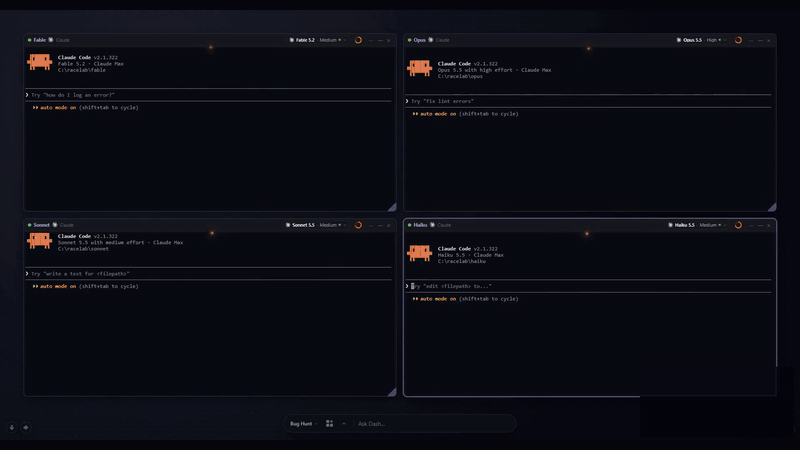

# Racelab

Race AI coding agents on the same planted bugs, with a real test suite as the judge.

**First result:** four Claude Code agents (Fable 5.2, Opus 5.5, Sonnet 5.5, Haiku 5.5) each got their own copy of
[qs](https://github.com/ljharb/qs) with 6 planted bugs (31 of 1,699 assertions failing). All four fixed all six, in all 3
runs. Median time: **Fable 2:20**, Opus 2:42, Sonnet 3:16, Haiku 4:08. Haiku used about 4x the output tokens of the
others every run. Full table and caveats: [RESULTS.md](RESULTS.md).



*Run 1, sped up. Recorded in [DASH](https://dashcanvas.dev/?utm_source=github&utm_medium=repo&utm_campaign=bf&utm_content=racelab), which runs the four agents side by side.*

## Run your own race

Needs Python 3.8+, Node and npm.

```
python race.py setup fable opus sonnet haiku
```
One bugged copy of qs per name in `races/<name>`, each with a fresh git history (one commit, bugs already in it), so no
agent can `git diff` its way to the answer. The first run installs qs's dev dependencies once; the copies share them.

Then open one agent per folder and paste [PROMPT.md](PROMPT.md) into all of them at the same moment. Then:

```
python race.py score
```
```
copy                     tests    time  tools  out tokens  note
fable         1,699/1,699 pass    3:04      8       3,349
haiku         1,699/1,699 pass    4:35     19      14,900
```
Tests come from running the suite in each copy. Time, tool calls and output tokens come from the newest Claude Code
transcript for that folder (`~/.claude/projects/`). Re-run `setup` for a fresh race with the same bugs.

**Works with any CLI agent:** a race is just folders, a prompt and a test suite. Codex, Gemini, Cursor or anything else
gets the pass/fail column; the time and token columns are read from Claude Code transcripts only.

## Honest by construction
- The answer key is `plant.py` (and `check.json`). It lives outside every race folder and is never copied in.
- The prompt tells each agent not to look outside its folder. `score` checks every tool call in the transcript and
  prints **OPENED THE ANSWER KEY** if one touched `plant.py`, `check.json`, the clean `qs/` copy or a `../` path.
  It is a string match on the transcript, not a sandbox.
- `python race.py selftest` checks the token counter on a small fixture and runs `plant.py check`, which applies each
  bug alone and confirms 6 of them break tests (31 assertions in total) and the control change breaks none.

## Files
- `race.py`: `setup`, `score`, `selftest`.
- `plant.py`: the bugs (`check` tries each one alone, `apply <dir>` plants the ones that break a test).
- `qs/`: a clean qs 6.17.1, under its own BSD-3-Clause license (`qs/LICENSE.md`). Thanks to Jordan Harband and the qs
  contributors.
- `PROMPT.md`, `RESULTS.md`.

Want another repo or language? Add bugs to `plant.py` the same way: the original line, the bugged line, a label.

MIT license for everything outside `qs/`.
